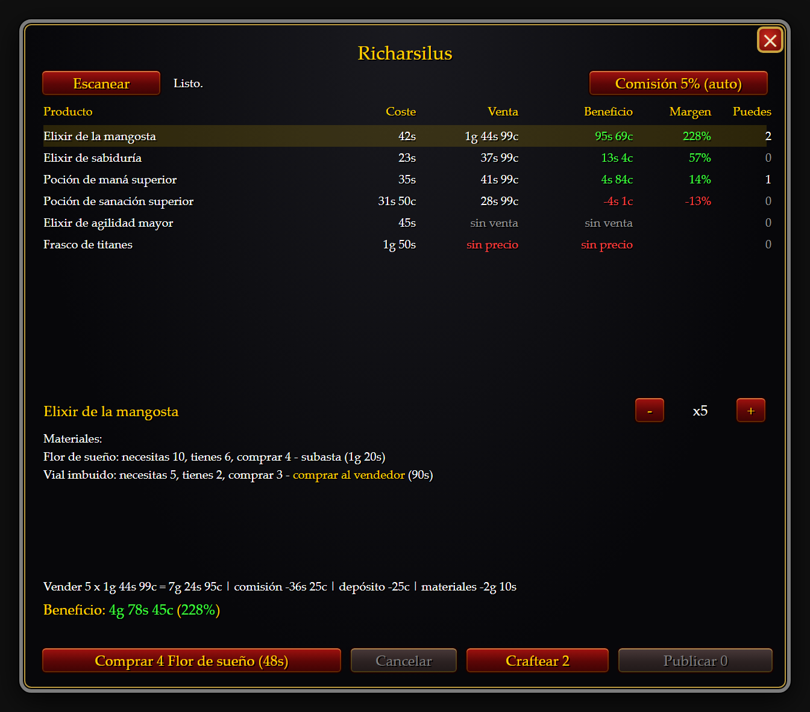
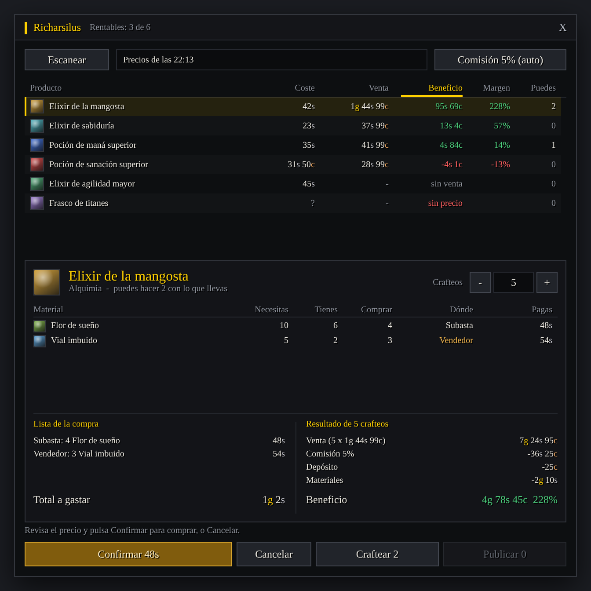

# Richarsilus

[](https://github.com/jotagalindo/richarsilus/actions/workflows/ci.yml)
[](https://github.com/jotagalindo/richarsilus/releases)

Addon para **World of Warcraft: Forever** que te dice qué crafteos dan dinero comprando los materiales en la
casa de subastas y vendiendo el resultado allí mismo, y te ayuda a hacerlo: un clic por acción.

- Lee tus recetas aprendidas de cualquier profesión (Alquimia, Sastrería, Herrería...).
- Escanea en la subasta solo los materiales y productos de tus recetas.
- Calcula el beneficio real: venta − **comisión** de la casa de subastas − **depósito** − materiales.
- Te arma la lista de la compra y te deja comprar, craftear y publicar con botones.

## Cómo se ve



> Las imágenes se generan con el código real del addon ejecutado sobre un cliente simulado y datos de ejemplo
> (`tools/ui-preview`). La disposición, los textos, los colores, los cálculos y los botones activos son los del addon;
> los precios y los nombres de las duraciones son de ejemplo, la fuente imita a la del juego y los iconos de los objetos
> se dibujan como cuadrados de color (en el juego salen los iconos de verdad y las duraciones que da el propio juego).

La ventana tiene un tema oscuro propio (no depende de las texturas de Blizzard) y se lee de arriba abajo, en el orden
en el que se usa:

**Barra superior:** **Escanear** consulta en la subasta los materiales y productos de tus recetas. A su lado, la
barra de estado dice qué hacer (abrir la profesión, abrir la subasta, escanear), muestra el progreso del escaneo y,
al terminar, la hora de los precios. **Duración** es cuánto tiempo quedarán publicadas las subastas que hagas con
*Publicar*: cada clic pasa a la siguiente opción del juego (con los mismos nombres que la ventana de venta de
Blizzard), se recuerda entre sesiones y es independiente de lo que tengas elegido en la ventana de Blizzard. El
depósito se recalcula al momento para la duración elegida. **Comisión** muestra la que se aplica (5 % o 15 %,
detectada por la zona) y al pulsarlo la cambia: auto → 5 % → 15 %. Junto al título, cuántas recetas son rentables.

**Tabla:** una fila por receta con el icono del producto, ordenada por **beneficio**. Pulsa la cabecera de una columna
para ordenar por ella (se recuerda entre sesiones); la columna activa queda subrayada. Las recetas sin precio quedan
siempre al final. Al pasar el ratón por una fila sale el tooltip del objeto.

| Columna | Qué indica |
|---|---|
| Coste | Lo que cuestan los materiales de **un** crafteo |
| Venta | Precio al que lo publicarías (1 cobre por debajo de la subasta más barata) |
| Beneficio / Margen | Venta − comisión − depósito − materiales, en verde si ganas y en rojo si pierdes |
| Puedes | Cuántos crafteos puedes hacer ya con lo que llevas en las bolsas |

Si no hay nadie vendiendo el producto aparece *sin venta*; si falta el precio de algún material, *sin precio*.

**Detalle de la receta elegida** (la más rentable al abrir; clic en otra fila para cambiarla):

- **Crafteos − 5 +**: aquí eliges **cuántos crafteos** quieres hacer (Mayús + clic = de 10 en 10, hasta 200). Todo lo
  demás se recalcula para esa cantidad.
- **Materiales**: una tabla con lo que necesitas, lo que tienes (en verde si te basta), lo que **te falta comprar**,
  dónde conviene comprarlo (subasta o vendedor) y lo que vas a **pagar**.
- **Lista de la compra**: lo que hay que comprar en la subasta (lo va comprando el botón **Comprar**, un material por
  clic), al vendedor (lo compras tú al hablar con él), lo que no se puede comprar porque no hay suficientes subastas,
  y el total a gastar.
- **Resultado**: venta, comisión, depósito, materiales y el **beneficio** final de todos los crafteos, como una
  factura. En *materiales* cuenta también lo que ya tienes, valorado a precio de mercado. El tooltip del depósito
  explica si es el del juego, uno estimado o uno aún desconocido.

**Botones de abajo** (cada clic hace una sola cosa). El botón del **siguiente paso** que te conviene se pinta en dorado
y la línea de encima te lo explica (o muestra el error si algo ha fallado). Todos los botones tienen tooltip.

| Botón | Qué hace |
|---|---|
| **Comprar 4 Flor de sueño (48s)** | Compra en la subasta el siguiente material de la lista de la compra, solo la cantidad necesaria para los crafteos elegidos y empezando por las subastas más baratas. Después de cada compra el botón pasa al siguiente material de la lista. Es un material por clic porque Blizzard solo permite una compra por clic, y cada una se confirma aparte. |
| **Cancelar** | Cancela una compra o publicación a medio confirmar |
| **Craftear 2** | Craftea lo que te permiten los materiales que llevas, hasta el número elegido (necesita la ventana de la profesión abierta) |
| **Publicar N** | Publica todas las unidades del producto que tengas en las bolsas al precio de la columna *Venta* |

Comprar va en dos clics, igual que en la interfaz de Blizzard: el primero pide el precio al servidor y el botón pasa
a **Confirmar**; la compra se hace en el segundo. Si el precio ha subido más de un 5 %, el addon cancela y te pide
volver a escanear.



## Instalación

1. Descarga `Richarsilus-X.Y.Z.zip` de la última [release](https://github.com/jotagalindo/richarsilus/releases) y
   descomprímelo dentro de `Interface\AddOns` del cliente de Forever (debe quedar
   `Interface\AddOns\Richarsilus\Richarsilus.toc`). Para encontrar la carpeta del juego: launcher de Battle.net →
   WoW: Forever → ⚙ → *Mostrar en el explorador*. Si `Interface\AddOns` no existe, créala.
   También puedes copiar a mano la carpeta `Richarsilus` de este repositorio.
2. Entra en el juego y comprueba en *AddOns* (pantalla de selección de personaje) que Richarsilus está activado.

## Uso

1. **Abre la ventana de tu profesión** una vez. El addon guarda tus recetas (verás
   `Alquimia: N recetas guardadas` en el chat). Repítelo cuando aprendas recetas nuevas.
2. **Habla con un vendedor de suministros** de tu profesión (viales, hilos...). El addon apunta sus precios para toda
   la cuenta y, si son más baratos que la subasta, te dirá "comprar al vendedor". Hazlo antes de comprar: mientras el
   addon no conozca a ese vendedor, no sabe que el vial se vende ahí y podría proponerte comprarlo más caro en la
   subasta.
3. **Ve a la casa de subastas.** La ventana de Richarsilus se abre a su lado. Pulsa **Escanear** (tarda ~1 s por objeto).
4. La tabla queda ordenada por **beneficio**. *Puedes* = cuántos crafteos puedes hacer con lo que ya llevas.
5. Elige una receta y la cantidad de crafteos con **− / +** (Mayús = de 10 en 10). Verás cada material: cuánto
   necesitas, cuánto tienes, cuánto comprar y dónde.
6. **Comprar**: el primer clic pide precio al servidor; el segundo (*Confirmar X*) compra. Si el precio ha subido más
   de un 5 % el addon cancela solo y te pide volver a escanear (igual que la interfaz de Blizzard).
7. **Craftear**: abre la ventana de la profesión (puedes hacerlo en la misma subasta) y pulsa *Craftear N*.
8. **Publicar**: publica todo lo que tengas del producto a 1 cobre por debajo de la subasta ajena más barata (o igual
   que la tuya si la más barata ya es tuya). Si el juego pide confirmación, pulsa otra vez.

## Cómo calcula

| Concepto | Regla |
|---|---|
| Materiales que compras | Se recorren las subastas de más barata a más cara para la cantidad exacta (comprar 20 hierbas cuesta lo que cuestan esas 20, no 20 × la más barata). Tus propias subastas no cuentan. Si el vendedor es más barato, se usa el vendedor. |
| Materiales que ya tienes | Valen su precio de mercado (lo que ganarías vendiéndolos). Así, si la hierba vale más que la poción, lo verás. |
| Precio de venta | Subasta ajena más barata − rebaja (1 cobre por defecto). |
| Comisión | Lo que se queda la casa de subastas cuando **vendes** (si no se vende, no se cobra; no depende de la duración). 5 % en casas de subastas de facción, 15 % en las neutrales (Gadgetzan, Bahía del Botín, Vista Eterna). Se detecta por zona; el botón de la comisión la cambia a mano (auto → 5 % → 15 %). |
| Depósito | Lo que pagas **al publicar**: se te devuelve si vendes y lo pierdes si la subasta caduca o la cancelas. Lo calcula el propio juego para cada objeto, cantidad y duración (cuanto más larga, más depósito; la ventana muestra la que se usa con el nombre que le da el juego, p. ej. *Depósito 8 Horas*). Por defecto cuenta como coste (opción conservadora; `/rs deposito off` para no contarlo). Para lo que se apila (pociones, elixires...) el juego lo da siempre. Para lo que no se apila (armas, armaduras...) solo lo da si tienes uno en las bolsas: el addon guarda cada depósito que le da el juego y lo reutiliza; si nunca lo ha visto, lo estima a partir del precio de venta al vendedor del objeto (en Forever el depósito es un porcentaje de ese precio) y lo marca como *estimado*, o como *desconocido* si aún no puede estimarlo. |
| Producción | Se usa la cantidad mínima que da la receta. |

## Comandos

| Comando | Qué hace |
|---|---|
| `/rs` | Muestra u oculta la ventana |
| `/rs escanear` | Escanea (con la subasta abierta) |
| `/rs comision 5\|15\|auto` | Fija la comisión |
| `/rs rebaja <cobre>` | Cuánto rebajar al publicar (por defecto 1) |
| `/rs deposito on\|off` | Contar o no el depósito como coste |
| `/rs duracion [horas]` | Sin número, muestra las duraciones que ofrece la casa de subastas (con los mismos textos que la ventana de venta de Blizzard) y la que se usa. Con número, la cambia (por ejemplo `/rs duracion 24`). Por defecto, la del medio de las tres. Cuanto más larga, más depósito |
| `/rs olvidar` | Borra las recetas guardadas de este personaje |

También funcionan en inglés (`scan`, `cut`, `undercut`, `deposit`, `duration`, `forget`) y con `/richarsilus`.

## Normas de Blizzard

El addon está hecho para cumplir los Términos de uso y la política de addons de Blizzard:

- Solo usa la API del propio juego. No hay programas externos, ni lectura de memoria, ni simulación de teclas.
- **Toda compra, crafteo y publicación es un clic tuyo**, y cada clic hace una sola acción. Ningún evento,
  temporizador ni bucle compra, confirma, craftea o publica por ti (puedes comprobarlo: esas llamadas solo están en
  `Core/Actions.lua` y solo se invocan desde los `OnClick` de `UI/MainFrame.lua`).
- El escaneo busca únicamente los objetos de tus recetas, uno a uno, a un ritmo máximo de 60 búsquedas por minuto
  (el límite documentado por Blizzard es 100/min) y respetando su sistema de espera.
- Es gratuito, el código es legible y no contiene anuncios ni peticiones de donativos.

## Qué conviene comprobar en el juego

El código se ha verificado contra la interfaz oficial de Forever (build 1.60.1) y con pruebas automáticas sobre un
cliente simulado, pero no en el cliente real. La primera vez que lo uses, fíjate en:

- Que tras abrir la profesión aparezca el mensaje de recetas guardadas.
- Que la comisión mostrada coincida con la casa de subastas en la que estás (si no, cámbiala con el botón).
- Que el depósito mostrado coincida con el que enseña la ventana de venta de Blizzard.
- Que `/rs duracion` liste las mismas duraciones que el desplegable de la ventana de venta de Blizzard.
- Que la ventana se vea como en las imágenes: iconos de los objetos, colores de las monedas, tooltips al pasar el
  ratón (también sobre botones desactivados) y el botón del siguiente paso en dorado.

Si algo falla, `/console scriptErrors 1` muestra los errores de Lua en pantalla.

## Desarrollo

Requisitos: Docker. El contenedor trae Lua 5.1 (la versión del cliente), [busted](https://lunarmodules.github.io/busted/),
[luacheck](https://github.com/lunarmodules/luacheck), shellcheck y zip.

```powershell
docker build -t richarsilus-dev tools
```

```powershell
docker run --rm -v "${PWD}:/addon" richarsilus-dev
```

El segundo comando ejecuta `luacheck .` y `busted`. Las pruebas están en `spec/`: unitarias por módulo y
`spec/addon_spec.lua`, que carga el addon en el orden del TOC sobre un cliente simulado (`spec/helpers/wow_stub.lua`)
y recorre el flujo completo de escanear, comprar, craftear y publicar. `spec/package_spec.lua` prueba el empaquetado.

Para generar el zip en local (queda en `dist/`):

```powershell
docker run --rm -v "${PWD}:/addon" richarsilus-dev sh tools/package.sh
```

El script comprueba que existen todos los ficheros que lista el TOC y que no hay ningún `.lua` fuera del TOC (el juego
no lo cargaría).

### Integración continua

[`.github/workflows/ci.yml`](.github/workflows/ci.yml) se ejecuta en cada push a `main` y en cada pull request, con la
misma imagen de Docker:

- **Lint**: `luacheck` (Lua y globales de WoW), `shellcheck` (`tools/package.sh`) y `actionlint` (los workflows).
- **Tests**: `busted` y empaquetado; el zip queda como artefacto de la ejecución.

### Publicar una release

1. Cambia `## Version:` en `Richarsilus/Richarsilus.toc` (por ejemplo a `0.0.4`) en tu rama.
2. Integra el cambio en `main` (por ejemplo, con un pull request).

Y ya está: [`.github/workflows/release.yml`](.github/workflows/release.yml) se ejecuta con cada cambio en `main`. Si la
versión del TOC aún no tiene etiqueta, pasa luacheck y los tests, empaqueta el addon, crea la etiqueta `v0.0.4` sobre
ese commit y publica la release con `Richarsilus-0.0.4.zip` y las notas generadas a partir de los commits. Si la
etiqueta ya existe (los cambios no suben la versión), no publica nada. Mientras la versión sea 0.x (fase beta,
pendiente de probar en el juego) la release se publica como *prerelease*; lo mismo ocurre con cualquier etiqueta con
guion (`v1.1.0-beta1`). La primera versión estable será la `1.0.0`.

También se puede publicar a mano subiendo la etiqueta (debe coincidir con la versión del TOC):

```powershell
git tag v0.0.4
```

```powershell
git push origin v0.0.4
```

| Fichero | Responsabilidad |
|---|---|
| `Core/Init.lua` | Tabla del addon, valores por defecto, base de datos guardada |
| `Core/Money.lua` | Formato `1g 2s 3c` |
| `Core/Pricing.lua` | Cálculo de costes, venta, comisión, depósito y beneficio |
| `Core/PriceDB.lua` | Precios escaneados y de vendedor |
| `Core/Deposit.lua` | Depósitos aprendidos y estimados de objetos no apilables |
| `Core/RecipeDB.lua` | Recetas leídas de `C_TradeSkillUI` |
| `Core/Scanner.lua` | Escaneo con límite de ritmo |
| `Core/Inventory.lua` | Bolsas |
| `Core/Actions.lua` | Compra, publicación y crafteo (únicas llamadas protegidas) |
| `Core/Session.lua` | Une todo lo anterior para la interfaz |
| `Core/Commands.lua` | `/rs` |
| `Core/Events.lua` | Eventos del juego |
| `UI/Widgets.lua` | Tema de colores y piezas de la ventana (paneles, botones, iconos, tooltips) |
| `UI/MainFrame.lua` | Ventana |
| `tools/package.sh` | Zip de la release |
| `tools/ui-preview/` | Imágenes de la interfaz del README (`render.ps1` las regenera en `docs/images/`) |
| `tools/Dockerfile` | Entorno de desarrollo y CI |

Diseño: [docs/superpowers/specs/2026-11-26-richarsilus-design.md](docs/superpowers/specs/2026-11-26-richarsilus-design.md).
Próximas mejoras propuestas: [docs/propuesta-mejoras.md](docs/propuesta-mejoras.md).
